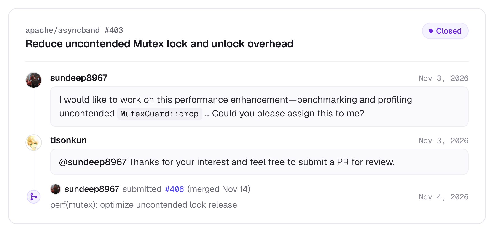
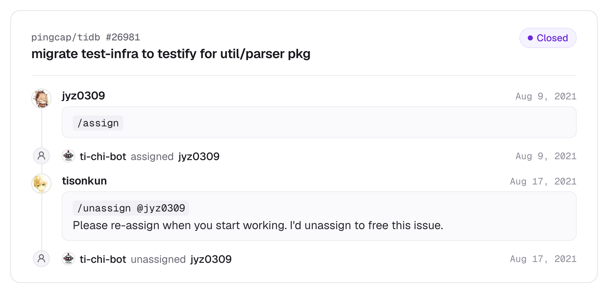
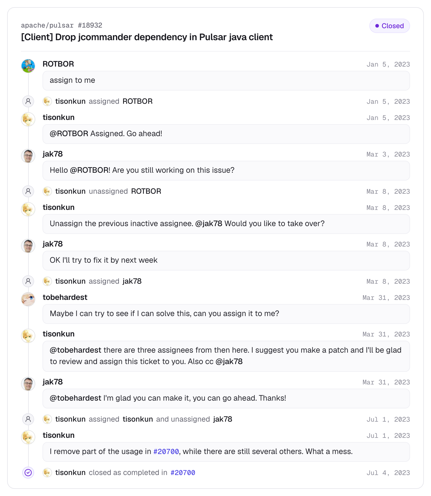
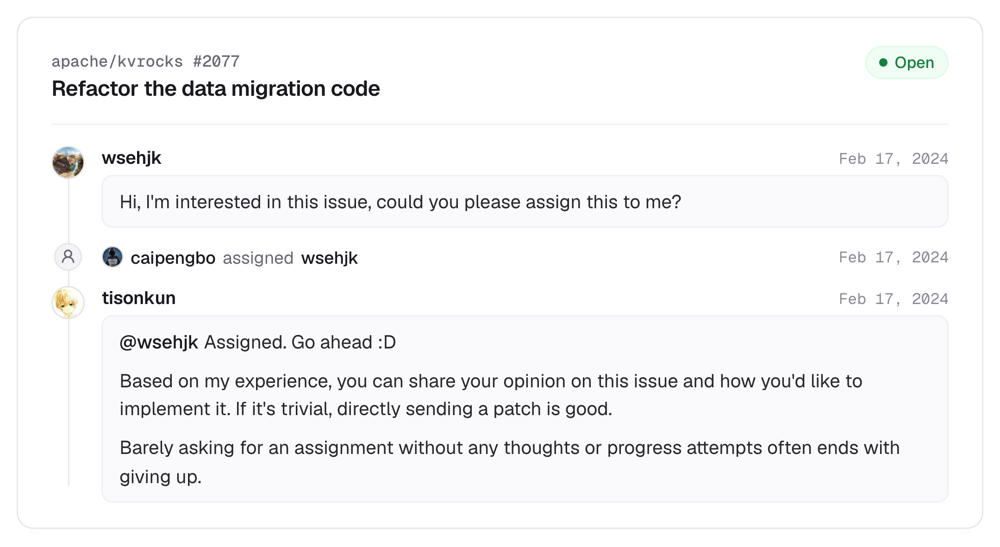
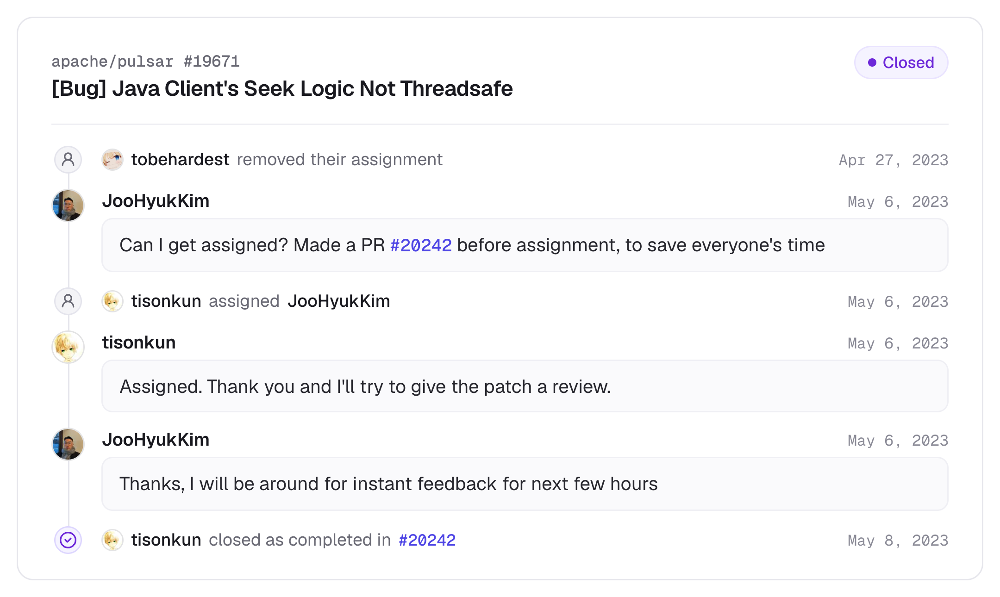
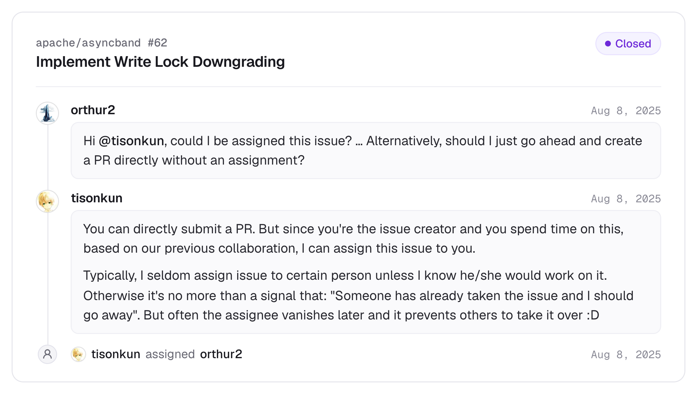

每次我看到自己维护的项目里有 Contributor 问能不能把某个 Issue Assign 给他，我都会回复一句：不要犹豫，你只管冲就完了。如果 PR 发出来，记得 Ping 我 Review 就行。

这个问题由来已久。十几年前，开源共同体就流行 [Don't Lick the Cookie](https://www.redhat.com/en/blog/dont-lick-cookie) 的说法。

其大致内容是：盘子里只剩最后一块曲奇，调皮的小孩眼下不想吃，又怕等会儿回来被别人拿走，就抓起来舔一口，再放回盘子里。这么一来，别人肯定不会动这块曲奇了，它多半就放在盘子里，没人吃。

在开源项目中，Assign 占位往往起到的就是这个先舔一口的效果。

<!-- more -->

## 我曾三度遭到背叛

早年维护项目，我也不是一开始就不喜欢 Assign 的。类似 2021 年 TiDB 集中迁移测试框架、2022 年 Apache Kvrocks 集中把 TCL 测试迁成 Go 代码，那一波全是拆得很碎的同质化小任务，我又有时间盯着看进度和支持，给 Assign 也还行。

但落到日常开源维护里，给 Assign 踩的坑就太多了。

例如，就在上面提到的这两轮工作里，我就时不时会遇到认领完一两周却毫无动静的情况，维护者还得定期巡检，自己跑去留一句 `Inactive. Unassign to release the seat.` 把坑腾出来。

又例如，我在 Apache Pulsar 项目里跟进过 [@syhily](https://x.com/@syhily) 开的一个很简单的依赖清理问题。前前后后来了三个 Contributor 说可以 Assign 给他，结果要么是提交了一个没法合并的半成品，要么干脆就没开始。最后还是我自己写了个 [PR-20700](https://github.com/apache/pulsar/pull/20700) 收尾。

于是后来我就不太相信这种 Ask for an assignment 的事情了。比如在 Kvrocks 项目里，我写到：

不出所料，这个 Issue Open 到现在也没啥下文。

反过来，先有 PR 再提 Assign 和 Review 就会流畅很多：

所以到了 Apache Asyncband (Incubating) 里，我索性挑明了说：除非我明确知道对方真的在推进，不然 Assign 唯一的实际作用就是贴一张“这活有人占了，其他人绕道吧”的告示。这只会让其他潜在的参与者望而却步，而是否被 Assign 完全不影响这个提请求的人自己推进工作。

BTW 上面这位 Contributor 后来持续参与，现在已经是 Asyncband PPMC 成员，并且主导过 Asyncband 版本发布。

从另一个角度看，Assignment 是公司派活流程在开源协作当中的投影。从上面的例子可以看到，公司主导的开源项目 TiDB 原生实现了 `/assign` 的能力，当然，如果我没记错的话，这是从 Kubernetes 那边抄过来的。

相反，在维护 ASF 的项目时，我的原则是不主动 Assign 别人，因为开源协作是志愿原则，不存在派活。当然，我现在又再极端了一点：哪怕别人主动要求 Assign 给他，我也会因为 Don't Lick the Cookie 的缘故几乎不会答应。如前所述，这也没什么用。

## 不 Assign 之后怎么样了？

这两年，我在活跃维护的几个项目里基本都改成了一律不 Assign 给别人，直接回一句：Go ahead 就行，直接提 PR 我来 Review 呀。

这就按照行动力把两类人群区分开来了。

一种是真打算动手的人，不 Assign 照样起飞：

- 在 Asyncband 的 [ISSUE-215](https://github.com/apache/asyncband/issues/215) 和 [ISSUE-222](https://github.com/apache/asyncband/issues/222) 里，[@bai_gao62556](https://x.com/@bai_gao62556) 不用 Assign 也能接连实现对应的两个大特性。他现在是 Asyncband PPMC 成员之一。
- DataSketches Rust 项目的 [ISSUE-363](https://github.com/apache/datasketches-rust/issues/363) 甚至连等我回复都省了，Contributor 写完计划直接提了个 [PR-371](https://github.com/apache/datasketches-rust/pull/371) 出来；另外像 OpenDAL 的 [ISSUE-6647](https://github.com/apache/opendal/issues/6647) 和 Fastrace 的 [ISSUE-186](https://github.com/fast/fastrace/issues/186) 也是不 Assign 直接放行，Contributor 照样可以直接冲完实现。

另一种人是不管你回不回他，反正也不开 PR 的：

- 以 Asyncband 的 [ISSUE-292](https://github.com/apache/asyncband/issues/292) 和 OpenDAL 的 [ISSUE-6619](https://github.com/apache/opendal/issues/6619) 以及 Logforth 的 [ISSUE-145](https://github.com/fast/logforth/issues/145) 为例，我都是当天就回了 Go ahead 或者明说不用 Assign 就能开工，结果对方之后彻底没了影，最后全是我自己提 PR 关掉的。
- 在 Asyncband 的 [ISSUE-388](https://github.com/apache/asyncband/issues/388) 里，有位 Contributor 留了句 Can I work on this 之后五天没动静，我自己提了个 [PR-409](https://github.com/apache/asyncband/pull/409) 修掉，并顺带回他下次不用问，我们不搞 Assign 那套。有意思的是他真听进去了，几天后在别人刚求完 Assign 的 [ISSUE-398](https://github.com/apache/asyncband/issues/398) 里，啥也没问直接交了个 [PR-412](https://github.com/apache/asyncband/pull/412) 过来。

## 往前多推一步

说到底，在 Issue 底下问一句能不能 Assign 给我，是个太 Low Effort 的事情了。动动手指敲一行字，就想给一个公开问题挂把排他锁，对更广泛的开源协作来说并不合理。

别人看到 Issue 有 Assignee 了，多半会绕开，而 Assignee 过两天忙起来，或者发现没那么好改，又不好意思专门回来取消认领，问题就这么晾在那里了。

尤其现在有了 AI 之后，口头认领的门槛更低了。让模型扫一眼代码，十来分钟就能在五六个问题底下写出看着好像那么回事的分析，然后顺手要个 Assign 占位。

所以，真想参与一个问题，其实没必要多问一句能不能 Assign 抢个锁。如果只是要留评论，那最好也往前多推一步。哪怕还没写完，本地把复现或者 Benchmark 跑一遍把数据贴上来，或者先开个半成品的 Draft PR 出来，大家都能对着具体的东西往下聊，比空口问一句能不能 Assign 给我有用得多。
